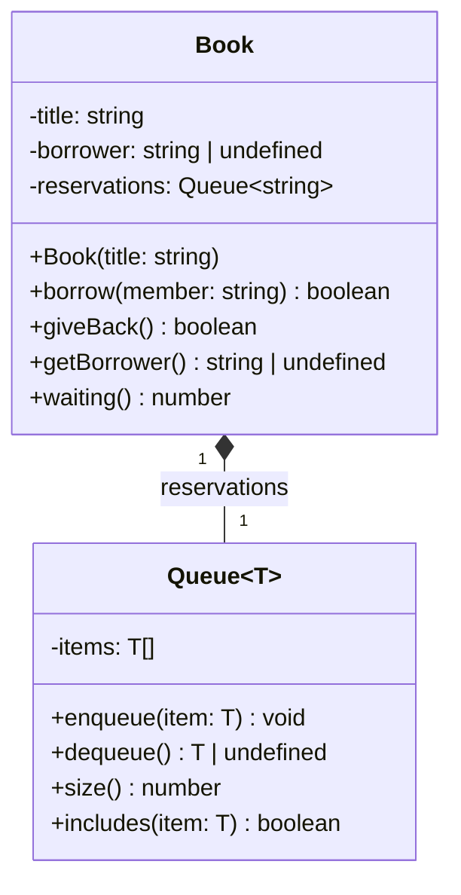

# Lab 4 — Generics in Practice

Object-Oriented Programming — DAUST Fall 2026

## Part 1 — The Problem

### Prediction 1

I expect no red underlines because `find()` returns `any`. The program should print `Awa`, then stop with `TypeError: awa.describe is not a function`, because `Member` has no `describe()` method.

### Question 1

Using `any` gives up type safety. `memberList.add(42)` is accepted by TypeScript, but it fails at runtime because `42` has no `getId()` method.

## Part 2 — A Generic Catalog

### Question 2

Both calls to `getId()` produce:

```text
Property 'getId' does not exist on type 'T'.
```

Without a constraint, `T` does not guarantee a `getId()` method. I use `T extends HasId` to require that method.

### Question 3

TypeScript uses structural typing. Both classes have the required public method, `getId(): string`, so they satisfy `HasId` without writing `implements HasId`.

### Question 4

**(a) Adding a `Member` to `books`:**

```text
Argument of type 'Member' is not assignable to parameter of type 'Book'.
  Type 'Member' is missing the following properties from type 'Book': title, describe
```

`Catalog<Book>` fixes `T` as `Book`, so `add(item: T)` prevents adding a member.

**(b) Creating `Catalog<number>`:**

```text
Type 'number' does not satisfy the constraint 'HasId'.
```

The constraint `T extends HasId` prevents using numbers because they have no `getId()` method.

**(c) Calling `found.describe()` without a guard:**

```text
'found' is possibly 'undefined'.
```

The return type `T | undefined`, together with strict checking, prevents calling a method on a possibly missing item.

### Prediction 2

I expect no test lines to change and the output to remain the same as Checkpoint 1. The public methods keep the same behavior.

### Question 5

The tests use public methods, not the private storage. Replacing the array with a map therefore does not change the caller's code. This is encapsulation.

### Question 6

```typescript
books.all().push(new Book("B-001", "Duplicate"));
```

If `all()` returned the internal array, this would bypass the duplicate check in `add()`. Returning a new array prevents changes to the catalog's entries through that array, although the item objects are still shared.

## Part 3 — Generic or Not?

### Question 7

```text
Property 'describe' does not exist on type 'Borrowable'.
```

After the guard, the result's static type is only `Borrowable`, which declares `lateFee()` but not `describe()`. The actual object is a `Dvd`, but the non-generic return type loses that information.

### Prediction 3

I expect `worstOverall` to have type `Book | Laptop | undefined`. Calling `worstOverall.describe()` should be rejected:

```text
'worstOverall' is possibly 'undefined'.
Property 'describe' does not exist on type 'Book | Laptop'.
  Property 'describe' does not exist on type 'Laptop'.
```

Even after a guard, `Laptop` has no `describe()` method. The guarded call to `lateFee(3)` should work and print `8000`.

### Question 8

A generic is worth it when the function returns a value whose type depends on the input type. `totalFees()` always returns a number, while `mostCostly()` returns an input item and should preserve its type. For the mixed array, `T` is `Book | Laptop`; the return type includes `undefined` because the function also accepts empty arrays.

## Part 4 — A Generic Class as a Part

### Question 9

I choose `T` as `string` in `new Queue<string>()` because the queue stores member names. If `Book` extended `Queue<string>`, a caller could write:

```typescript
book.dequeue();
```

This would remove the first waiting member without giving them the book, bypassing the borrowing rules.

### Question 10

The first call adds Moussa to the queue; the second changes nothing because he is already waiting. Both return `false`, so the caller cannot distinguish a new reservation from an unchanged request, including when the member already has the book.

### Task 3 — Class diagram



### Question 11

I chose composition because each book creates and owns one private reservation queue. Each queue belongs to one book, giving multiplicities of `1` at both ends. Here, `T` is `string`.

## Part 5 — What Generics Cannot Do

### Prediction 4

```text
'T' only refers to a type, but is being used as a value here.
```

I expect the program to stop with `ReferenceError: T is not defined`, rather than print `true` or `false`. The type parameter `T` does not exist as a value at runtime.

### Prediction 5

I expect:

```text
Things Fall Apart
NaN
```

The JSON contains `title` but not `copies`. Therefore, `copies` is `undefined`, and adding `1` gives `NaN`.

### Question 12

TypeScript types are erased at runtime, so `T` cannot be used as a runtime constructor and `parseJson<BookData[]>()` does not validate the JSON structure. External data must be checked after parsing, before using it as trusted data. Here, I would validate the array and each item's `id`, `title`, and `copies` properties using runtime checks.

## Part 6 — Ratings

### My design

I use a map keyed by item ID, storing the item, total stars, and rating count. Only whole numbers from `1` to `5` are accepted. For tied averages, I keep the item whose first valid rating was recorded first.

### Question 13

If `best()` returned `HasId | undefined`, I could only rely on `getId()` after checking that the result exists. I could no longer call `describe()` for a book or `getName()` for a member directly. Returning `T | undefined` preserves those methods.

## Reference

[Node.js — Modules: TypeScript](https://nodejs.org/api/typescript.html)
